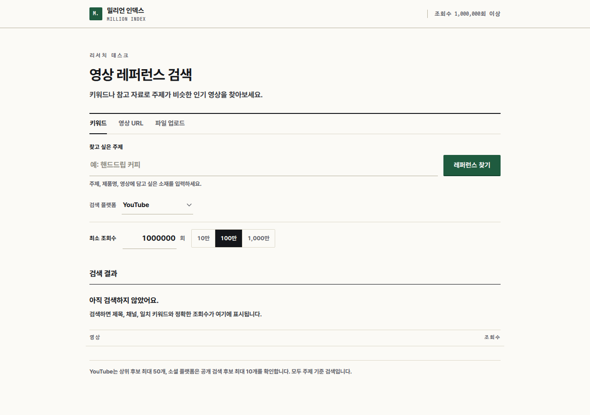

<h1 align="center">밀리언 인덱스 · Million Index</h1>

<p align="center"><strong>키워드와 레퍼런스에서 시작하는 영상 리서치 데스크</strong></p>
<p align="center">YouTube · TikTok · Instagram 릴스</p>



## 어떤 도구인가요?

키워드, 공개 영상 URL, 또는 기획서·자막 파일에서 검색어를 뽑아 **주제가 비슷한 공개 영상**을 찾는 로컬 웹앱입니다. Instagram 릴스 URL을 넣고 TikTok에서 검색하는 식으로, 입력 링크와 검색 플랫폼을 다르게 선택할 수도 있습니다.

| 플랫폼 | 검색 | 지표와 정렬 |
| --- | --- | --- |
| **YouTube** | YouTube Data API v3 | 최소 조회수, 관련도순·조회수순·최신순 |
| **TikTok** | 공개 웹 인덱스 | 상위 후보 최대 8개의 공개 페이지에서 커버와 재생수 확인. 최소 재생수·재생수순 지원, 미확인 후보 별도 표시 |
| **Instagram 릴스** | 공개 웹 인덱스, 후보 부족 시 검색어 보강 | 상위 후보 최대 5개의 공개 페이지에서 썸네일 및 공개 조회수 확인. 제공되지 않는 수치는 미확인 |

OpenRouter 키를 설정하면 **Jev 최신 모델**이 TikTok·Instagram 후보의 제목을 평가해 검색어와 무관한 결과를 걸러냅니다. 모델은 조회수와 썸네일을 추정하지 않습니다.

## 로컬에서 실행

**필요 환경:** Python 3.10 이상. Python 패키지 설치 없이 실행할 수 있습니다.

```bash
git clone https://github.com/DeclanJeon/million-index.git
cd million-index
install -m 600 .env.example .env   # 최초 설정 시에만 실행
```

로컬 편집기로 `.env`를 열어 필요한 키를 `이름=값` 형식으로 입력하세요.

| 변수 | 용도 |
| --- | --- |
| `YOUTUBE_API_KEY` | [YouTube Data API v3](https://console.cloud.google.com/apis/library/youtube.googleapis.com) 검색 및 YouTube URL 설명 읽기 |
| `BRAVE_SEARCH_API_KEY` | [Brave Search API](https://brave.com/search/api/)로 TikTok·릴스 후보 검색 |
| `OPENROUTER_API_KEY` | 선택 사항 · [OpenRouter](https://openrouter.ai/keys)의 Jev를 사용해 공개 영상 제목 관련도 판정 |

```bash
python3 app.py
```

브라우저에서 **http://127.0.0.1:8765/** 를 열어 사용합니다. 포트 변경 예: `PORT=8766 python3 app.py`.

**Linux에서 키를 터미널로 입력하려면** `./start-with-key.sh`(YouTube), `./start-with-key.sh --brave`, `./start-with-key.sh --openrouter`를 사용하세요. `.env`는 Git에 포함하지 않습니다. Brave 키가 없는 상태에서 소셜 검색을 시험하려면, 선택적으로 인접한 `flucto/` 폴더에 Flucto 빌드(`dist-electron/cli/index.js`)와 실행 환경이 있어야 합니다.

## 입력과 한계

- **키워드 / 영상 URL / 파일:** 파일은 UTF-8 `.txt`, `.md`, `.srt`, `.vtt` 형식이며 최대 256 KB입니다. 파일 자체를 보관하지 않지만, 추출한 검색어는 선택한 검색 제공자에 전송됩니다. Jev 사용 시 검색어와 공개 후보 제목도 OpenRouter에 전송됩니다.
- **관련도:** 공개 제목·설명을 기반으로 주제를 비교합니다. 영상의 컷 편집이나 촬영 스타일을 분석하지 않습니다.
- **검색 범위:** 플랫폼 전체를 검색하지 않습니다. 공개 색인과 API 할당량에 따라 결과가 달라집니다. TikTok은 전체 영상 주소를 사용하세요.
- **공개 지표:** 조회수·썸네일을 제공하지 않는 영상은 미확인 또는 대체 이미지로 표시합니다. 좋아요 수로 조회수를 대신하지 않습니다.
- **배포:** 현재 로컬용입니다. 외부 공개 서비스 운영 전에는 인증, 요청 제한, 비밀 관리와 모니터링이 필요합니다.

## 개발 및 검증

```bash
python3 -m unittest -v
```

- [디자인](DESIGN.md)
- [로컬 검증 기록과 배포 전 체크리스트](docs/local-release-readiness.md)
